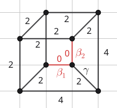

# Calabi--Yau Edges (Figure 5.2)

Recall Figure 5.2 from the companion article:



In this section, we provide the code that calculates $H_2(X;\mathbb{Z})$ and $\int_{C_e} c_1(T_X)$ for the GKM graph depicted in Figure 5.2 of the article.
First, we construct the GKM graph using the following code.

```jldoctest Figure_5_2; setup = :(using Oscar, GKMtools) 
julia> g = Graph{Undirected}(8);

julia> labels = [Vertex("v_$i") for i in 1:8];

julia> M = free_module(ZZ, 2);

julia> (t1, t2) = gens(M);

julia> w = Dict{Edge, AbstractAlgebra.Generic.FreeModuleElem{ZZRingElem}}();

julia> vertex_flags = [FlagWeight{ZZRingElem}[] for _ in 1:8];

julia> edge_flags = Dict{Edge, Tuple{Int, Int}}();

julia> weights_of_G = [t1, t2, -t1, -t2];

julia> weighted_edges = [
       (i, i % 8 + 1, weights_of_G[(i - 1) % 4 + 1])
       for i in 1:8];

julia> append!(weighted_edges, [
       (1, 5,  t1 + t2),
       (2, 6, -t1 + t2),
       (3, 7, -t1 - t2),
       (4, 8, -t1 - t2)]);

julia> for (u, v, w) in weighted_edges
       add_edge!(g, u, v)
       # Match the orientation used by Oscar's graph.
       e = Edge(u, v) in edges(g) ? Edge(u, v) : Edge(v, u)
       w_source = src(e) == u ? w : -w
       push!(vertex_flags[src(e)], FlagWeight(w_source))
       push!(vertex_flags[dst(e)], FlagWeight(-w_source))
       edge_flags[e] = (length(vertex_flags[src(e)]),length(vertex_flags[dst(e)]))
       end

julia> data = GKMCombinatorialData(
       g, M, labels, vertex_flags, edge_flags);

julia> G = gkm_graph(data)
GKM graph with 8 nodes, valency 3 and axial function:
v_2 -> v_1 => (-1, 0)
v_3 -> v_2 => (0, -1)
v_4 -> v_3 => (1, 0)
v_5 -> v_1 => (-1, -1)
v_5 -> v_4 => (0, 1)
v_6 -> v_2 => (1, -1)
v_6 -> v_5 => (-1, 0)
v_7 -> v_3 => (1, 1)
v_7 -> v_6 => (0, -1)
v_8 -> v_1 => (0, -1)
v_8 -> v_4 => (1, 1)
v_8 -> v_7 => (1, 0)
Algorithmic connection for GKM graph with 8 nodes and valency 3
```

Having defined `G` in this way, we can read off the curve classes as follows to obtain Figure 5.2:

```jldoctest Figure_5_2
julia> print_curve_classes(G)
v_2 -> v_1: (0, 1, 1), Chern number: 4
v_3 -> v_2: (1, 1, 0), Chern number: 4
v_4 -> v_3: (0, 0, 1), Chern number: 2
v_5 -> v_1: (0, 1, 0), Chern number: 2
v_5 -> v_4: (1, 0, 0), Chern number: 2
v_6 -> v_2: (0, 1, 0), Chern number: 2
v_6 -> v_5: (0, -1, 1), Chern number: 0
v_7 -> v_3: (0, 1, 0), Chern number: 2
v_7 -> v_6: (1, -1, 0), Chern number: 0
v_8 -> v_1: (1, 0, 0), Chern number: 2
v_8 -> v_4: (0, 1, 0), Chern number: 2
v_8 -> v_7: (0, 0, 1), Chern number: 2
```

The curve classes $\beta_1$, $\beta_2$, and $\gamma$ from Figure 5.2 thus correspond to $(0, -1, 1)$, $(1, -1, 0)$, and $(0, 1, 0)$, respectively, in the output.
